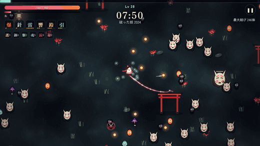

# 綾取り夜行 — AYATORI YAKO

**▶ プレイ（GitHub Pages）: https://onego15.github.io/survivors-claude/**

紅い糸で妖（あやかし）の群れを囲み、「結び」で一網打尽にする和風アクションローグライト。
Vampire Survivors の「大量の敵を倒して育てる」快感に、**一筆書き・陣取りゲーム（Qix／綾取り）の「囲む」遊び**を融合しました。ブラウザだけで動作し、1ラン約12〜13分で3体の大妖を倒すとエンディングです。



> 上の GIF は実際のゲームを自動操縦ボットで動かし、1フレームずつ録画したものです（8分前後：大きな輪で群れを締め上げ → 2体目の大妖「百目灯」出現）。
> 最終ボス戦を含む約32秒の MP4: [docs/demo.mp4](docs/demo.mp4)

---

## 1. 概要

- ジャンル：アクションローグライト（サバイバー系 × 囲い込みパズルアクション）
- 1ラン：約12〜13分（4分・8分・12分に大妖が出現、12分の「夜織」を倒すとクリア）
- 操作：移動とダッシュだけ。攻撃は「動き方」そのもの
- 対応：PC（キーボード／マウス）、スマホ（タッチ・仮想スティック）
- 形式：ビルド不要の静的 Web アプリ（HTML + JavaScript ES Modules + Canvas 2D + WebAudio）

## 2. 独自メカニクスと企画意図

### Vampire Survivors の面白さの分析
1. **操作は移動だけ**なのに、敵の群れの中を泳ぐ位置取りの判断が常に要求される
2. **自動攻撃が育つ**ことで、序盤の脅威が後半には爽快な「掃除」に変わる
3. **レベルアップの選択とシナジー／進化**で毎回違うビルドが完成する
4. **画面を埋め尽くす敵とエフェクト**の量そのものが報酬になる

### 組み合わせたもの：一筆書きの「囲い込み」
「移動するだけ」という VS の核を残したまま、**移動の軌跡そのものを武器**にしました。

- プレイヤーの背後には常に**紅い糸**がたなびき、長さには上限があります。
- 群れの周りを回り、**自分の糸を横切ると輪が閉じ**、内側の妖すべてが締め上げられます（＝「結び」）。
- **一度に多く捕らえるほどダメージ倍率が上がる**（最大 ×5）ため、「危険を承知で大群を誘導し、大きく囲む」判断が報われます。
- 糸に触れた妖は**絡まって鈍る**ので、囲い込みと防御が一体になっています。
- 輪の中の魂玉（経験値）はまとめて回収。**囲む＝攻撃・回収・防御**のすべてです。

### 戦闘・成長・判断への接続
| 要素 | 囲い込みとの関係 |
|---|---|
| 結術（8種） | 輪が閉じた瞬間に発動する追加効果：爆発・連鎖雷・結界・重力・花弁・残響（再締め）・折鶴・刃糸 |
| 御守（3種） | 自動攻撃。囲い込み中の身を守る補助（針・鈴・狐火） |
| 心得（8種） | 糸の長さ・締め付け・会心・移動など、輪の描き方を変えるパッシブ |
| 結び直し（11種の進化） | 結術／御守 Lv5 ＋ 対応する心得で進化。例：爆結＋鋼糸 →「大輪華」、刃糸＋長糸 →「斬鉄糸」 |
| 敵 | **糸切り（鋏の妖）**は糸を断ち切る、**跳傘**は突進で輪から逃げる、**鬼火**は遠距離から妨害 … 囲い方を変えさせる敵 |
| 大妖 | 大鋏（突進で糸を切る）、百目灯（漂う提灯・弾幕）、夜織（女郎蜘蛛・巣で移動を阻害）。糸を絡めて**縛り**、輪で囲むのが攻略の鍵 |
| 連（コンボ） | 2.6秒以内に続けて結ぶとダメージ上昇。15体以上で「大結び」 |

「どこを・どれだけの大きさで・いつ閉じるか」がプレイヤーの腕と判断としてそのまま結果に出る、というのが設計の狙いです。

## 3. ゲームの特徴

- **キャラクター3人**（糸の色ごとに特性と初期結術が異なる）
  - ユイ（紅の糸）：バランス型、「爆結」
  - シロガネ（銀の糸）：糸が長く「刃糸」持ち、体力低め ※大鋏撃破で解放
  - アイ（藍の糸）：高体力、「封陣」持ち、やや遅い ※百目灯撃破で解放
- **レベルアップ時に3択**（数字キーで選択、引き直しあり）、大妖・強敵が落とす**玉手箱**で追加強化
- **11種の進化**（結び直し）。進化すると演出も変化（花火の連鎖、雷の網、黒い渦、鳳凰、狐の嫁入り…）
- **敵8種＋大妖3体＋イベント**（妖の輪・紙魚の群れ・強敵出現）、時間とともに難度上昇
- **工房（メタ強化）**：ランで得た糸巻で永続強化（体力・糸の長さ・身代わり人形など8種）
- **手続き生成 BGM・効果音**：WebAudio で琴・太鼓・鈴・笛を合成。陰旋法のBGMが戦況に応じて5段階で盛り上がる
- 輪が閉じる直前の**金色の予告**、結びの**「結」スタンプ**、締め付けの線演出、画面外の大妖マーカーなど、情報の読みやすさを重視

## 4. 操作方法

| 操作 | PC | スマホ |
|---|---|---|
| 移動 | WASD／矢印キー／マウス長押し | 画面左側をドラッグ（仮想スティック） |
| ダッシュ（短い無敵） | Space／Shift | 右下のボタン |
| ポーズ | Esc／P | 右上のボタン |
| 強化の選択 | 1〜3 キー／クリック、R で引き直し | タップ |

初回プレイ時は画面上のヒントで「糸を伸ばす → 輪を閉じる → 群れを囲む」を順に案内します。タイトルの「遊び方」でも図解しています。

## 5. プレイ URL とローカル起動

- **GitHub Pages**: https://onego15.github.io/survivors-claude/
  - `gh-pages` ブランチから配信しています。`claude/project-thread-k528x0`（このリポジトリの既定ブランチ）または `main` に push すると、GitHub Actions（`.github/workflows/pages.yml`）がスモークテストを実行し、成功したら静的ファイルを `gh-pages` に公開します。
  - 全アセットは相対パスで読み込むため、`/survivors-claude/` のサブパスでも動作します。
- **ローカル起動**（ビルド不要）:
  ```bash
  git clone https://github.com/onego15/survivors-claude.git
  cd survivors-claude
  python3 -m http.server 8000   # または npx serve など任意の静的サーバー
  # ブラウザで http://localhost:8000/ を開く
  ```
  ※ ES Modules を使うため `file://` で直接開くことはできません。

### 開発・検証用 URL パラメータ
| パラメータ | 内容 |
|---|---|
| `?autoplay&build=burst` | 自動操縦ボットでプレイ（build: burst / thunder / seal / razor / random） |
| `&seed=7` | 乱数シード固定 |
| `&t=470` | ボットで指定秒まで早送りしてから開始 |
| `&god` | 無敵（テスト用） |
| `?unlockall` | 全キャラ解放 |

## 6. 使用した AI サービスとモデル

- AI サービス：**Anthropic Claude（Claude Code on the web／Claude のプロジェクト機能から起動されたクラウドセッション）**
- 正確なモデル名：**未確認（本 README には記載していません）**
  - 制作環境の運用ルールにより、リポジトリへ push するファイルにはモデル識別子を書かない決まりになっているため、ここには記載していません。セッション情報から確認できたモデル識別子は、制作スレッドのチャット返信で依頼者に報告しています。
- 企画・コード・グラフィック（コード描画のスプライト）・BGM／効果音（WebAudio 合成）・テスト・README はすべてこのセッション内で AI が作成しました。外部の画像・音声素材は使用していません（フォントのみ Google Fonts）。

## 7. 使用技術

- 言語：JavaScript（ES Modules、ビルドツールなし）
- 描画：HTML5 Canvas 2D（スプライトは起動時にコードで描画してキャッシュ、加算合成のグロー、パーティクル）
- サウンド：Web Audio API による手続き生成（外部音源ファイルなし）
- UI：DOM オーバーレイ ＋ CSS
- フォント：Google Fonts（Zen Antique、Zen Kaku Gothic New）
- ゲームエンジン：なし（自作。ゲームロジックは DOM 非依存で Node.js 上でもヘッドレス実行可能）
- テスト：Node.js（ヘッドレスシミュレーション）、Playwright＋Chromium（ブラウザ検証・録画）、ffmpeg（GIF／MP4 変換）
- 公開：GitHub Actions ＋ GitHub Pages（gh-pages ブランチ）

### ファイル構成
```
index.html / style.css
src/main.js     入力・画面遷移・セーブ・ゲームループ
src/game.js     ゲーム本体（糸・輪・結術・敵・大妖・成長）
src/data.js     強化・進化・キャラ・敵・ウェーブ定義
src/render.js   描画・カメラ・演出
src/sprites.js  コード描画のスプライト生成
src/audio.js    BGM・効果音の合成
src/ui.js       タイトル・HUD・レベルアップ・リザルトなどの UI
src/bot.js      自動操縦ボット（テスト・録画・タイトル画面のデモ用）
tests/          スモークテスト・シミュレーション・スクリーンショット／録画スクリプト
```

## 8. 制作日時

| 項目 | 日時（UTC） | 日本時間（JST） |
|---|---|---|
| 制作開始（依頼メッセージ受信） | 2026-10-25 23:10 | 2026-10-26 08:10 |
| 制作終了（最終コミット） | 2026-10-26 00:28 | 2026-10-26 09:28 |
| 経過時間 | 約1時間18分 | |

※ 開始はセッション記録の依頼送信時刻、終了は README を含む最終コミットの時刻です。途中の作業時間の内訳は未確認です。

## 9. 実施したテストと結果

### 自動テスト（`node tests/smoke.mjs`、CI でも毎回実行）
| テスト | 結果 |
|---|---|
| 糸で円を描くと輪が閉じ、内側の敵が倒れる | ✅ 合格 |
| 全強化・全進化を同時に取得し、5分時点から100秒稼働（NaN・例外・進行不能なし） | ✅ 合格 |
| 3キャラそれぞれでボットが150秒プレイ（Lv3以上・結び5回以上） | ✅ 合格 |
| 開始 → 大妖3体撃破 → エンディング（`win`）まで通しプレイ（無敵ボット） | ✅ 合格（約761秒で到達） |

### シミュレーション（`node tests/sim.mjs 3 all 1`、無敵なしのボット、15ラン）
| ビルド | クリア | 平均到達時間 | 平均撃破大妖数 |
|---|---|---|---|
| 爆結（burst） | 2/3 | 646秒 | 2.33 |
| 刃糸（razor・シロガネ） | 1/3 | 736秒 | 2.33 |
| 雷結（thunder） | 0/3 | 741秒 | 1.67 |
| ランダム | 0/3 | 737秒 | 1.67 |
| 封陣（seal・アイ） | 0/3 | 485秒 | 0.33 |

- 複数ビルド（爆結型・刃糸型）でボットでもクリアを確認。ボットは人間より囲い込みが下手なため、難度の目安は「ボットで2割、上手な人間ならより高い」と想定していますが、人間による通しプレイの勝率は未確認です。
- 全ランで NaN／例外なし。1ステップあたり平均 0.15〜0.75 ms、最大同時敵数 約400体、敵弾 最大約260発。

### ブラウザでの検証（Playwright + Chromium）
- `node tests/e2e.cjs`：実ブラウザでラン開始 → 死亡 → リザルト → 「もう一度」で新しいランが始まることを自動確認 ✅ 合格（ページエラーなし）
- タイトル → キャラ選択 → プレイ → レベルアップ → 玉手箱 → ポーズ → 死亡／クリア → リザルト → リトライ の画面遷移をスクリーンショットで確認
- スマホ相当のビューポート（縦長）で UI 崩れがないことを確認
- 8分（大妖2体目）と12分（最終ボス）付近を録画し、演出と視認性を確認（`docs/demo.gif`、`docs/demo.mp4`）
- 公開物（`gh-pages` ブランチの内容）を `/survivors-claude/` サブパスで配信し、読み込みエラーなしで起動・プレイできることを確認

### GitHub Pages
- GitHub Actions の `Deploy to GitHub Pages` と GitHub の `pages build and deployment` が成功していることを API で確認しました。
- ただし制作環境のネットワーク制限により **github.io へ直接アクセスできず、公開 URL をブラウザで開いての動作確認は未確認**です。

## 10. 改善した内容（初期実装後）

**ゲーム性・バランス**
- ボットが輪を閉じられない問題 → 糸の始点付近に戻ると閉じる「スナップ補助」（22px）を追加し、人間にも閉じやすく
- 糸切りが糸を切りすぎて遊びが成立しない（1ランで1000回以上） → 同時出現数の上限・クールダウン・切断後の気絶を追加
- 蜘蛛の巣が糸を切って囲い込みを妨げる → 移動を遅くするだけに変更
- 大妖が速すぎて囲めない → 糸に触れ続けると「縛り」状態になり、輪で囲むと拘束される仕組みを追加（大妖戦の中心に囲い込みを据えた）
- 縫針（自動攻撃）が強すぎて囲い込み不要になる → 弱体化し、ダメージの大半が「結び」から出るよう調整
- 最終ボスが群れに埋もれて見えない → 出現時に雑魚を散らす・ボス周囲から押し出す・最前面に描画

**グラフィック・演出**
- 敵・プレイヤーの縁取りスプライト、被弾フラッシュ、グロー、地面タイルと小物（灯籠・鳥居・彼岸花・地蔵）
- 結びの「結」スタンプ、締め付け線、輪の予告（金色の円）、大妖の縛り演出（巻き付く糸＋「縛」）
- 鬼火の光量を下げ、大群でも情報が読めるよう調整

**UI/UX**
- 初回チュートリアルヒント（リザルト画面では非表示に修正）、図解つき「遊び方」
- スマホ表示でタイトルロゴが折り返す問題を修正
- HUD に糸の残り長さ、連（コンボ）、大妖の体力バーを表示

**不具合修正**
- 初回フレームで経過時間が負になり糸の点が壊れる問題を修正
- テスト用の無敵指定がレベルアップで解除される問題を修正

## 11. 制作に使用した依頼プロンプト（全文）

```
Vampire SurvivorsやBALL x PITに着想を得た、独創的なアクションローグライトゲームを制作してください。
Vampire Survivorsのような、大量の敵を倒しながら能力を強化し、強力なビルドを完成させていく楽しさをベースとしつつ、既存のサバイバー系ゲームとは一味違う、独自のゲームメカニクスを考案してください。
BALL x PITがサバイバー系ゲームにブロック崩しの要素を融合したように、別ジャンルの遊びや独創的な仕組みを組み合わせて、新しいゲーム体験を生み出してください。
ただし、ブロック崩しを採用する必要はありません。どのようなアイデアにするかは完全に任せます。
ブラウザで快適に遊べる、商業インディーゲームのような完成度を目指してください。
最も重視するのは、独創的で面白いゲームシステム、何度も遊びたくなる成長・強化要素、気持ちのよいアクション、統一感のある美しいグラフィック、洗練されたUI/UXです。
1. ゲームの企画・独創性（最重要）
まず、Vampire Survivorsの基本的な面白さを分析したうえで、そこに組み合わせる独自のゲームメカニクスを考案してください。

* 単に新しい武器や敵を追加しただけのVampire Survivorsクローンにはしない
* 別ジャンルの遊びや、新しい操作・物理法則・戦略システムなどを組み合わせる
* 新しい仕組みが、戦闘、成長、プレイヤーの判断に直接関係するようにする
* 二つのゲームを別々に実装するのではなく、相互に作用する一つのゲーム体験に統合する
* その仕組みならではの戦略、爽快感、意外性を生み出す
* 初めて遊ぶ人でも基本ルールを短時間で理解できる
* 独創性だけでなく、実際に遊んで面白いことを優先する

ゲームの世界観、タイトル、基本ルール、独自メカニクスは自由に決定してください。
企画だけで終わらず、実際にゲームとして完成させてください。
2. ゲーム内容

* 大量の敵と戦うアクションローグライト
* プレイ中に経験値や報酬を集めて成長する
* レベルアップ時などに複数の強化候補から選択できる
* 武器、能力、特殊効果などの組み合わせによるシナジーがある
* プレイが進むほど攻撃や演出が進化し、強くなったことを実感できる
* 特徴的な敵やボスが登場する
* 1回10〜20分程度で一区切りつく
* 繰り返し挑戦することで異なるビルドや戦略を楽しめる

一般的なサバイバー系の仕組みは必要に応じて変更して構いません。独自メカニクスを活かしたゲームデザインを優先してください。
3. グラフィック・アートディレクション

* 商業インディーゲームのような完成度の高いビジュアル
* 世界観、キャラクター、敵、背景、UI、エフェクトに統一感を持たせる
* 2D、3D、HD-2D、ドット絵、手描き風など表現方法は自由
* 攻撃、敵の撃破、レベルアップ、能力の進化などに気持ちのよい演出を用意する
* 独自メカニクスの魅力が視覚的に伝わる表現を工夫する
* 大量の敵やエフェクトが出ても画面の情報が読み取れるようにする
* 単純な図形や仮素材を並べただけの技術デモのような見た目で完成としない
* BGMや効果音も含め、一つの作品としてアートディレクションする

グラフィックの美しさだけでなく、遊びの気持ちよさが伝わる演出を重視してください。
4. ゲームバランス・UI/UX

* 初心者でも直感的に操作できる
* 独自メカニクスの使い方を自然に理解できる
* レベルアップ時の選択に戦略的な意味がある
* 異なるビルドや能力の組み合わせが成立する
* 強化によってゲームの展開や遊び方が変化する
* 徐々に難しくなり、終盤には達成感のある戦闘を楽しめる
* プレイヤーの上達や判断が結果に反映される
* 操作説明、HP、成長状況、強化選択などのUIが分かりやすい
* 演出が派手でも操作性や視認性を損なわない

5. 技術・制作方針

* ブラウザで快適に動作することを必須とする
* ゲームエンジン、フレームワーク、言語、アセット制作方法は自由
* 必要なら適切なライセンスの公開アセットを活用してよい
* 既存作品の固有キャラクター、デザイン、音楽、ステージなどはコピーしない
* コンテンツ量よりも独創性と完成度を優先する
* 私への途中確認や質問は不要

独自メカニクスについては、技術的に実現できる範囲で最も面白いアイデアを選択してください。
6. 品質改善・自律制作（最重要）
ゲームが動くようになっただけで完成と判断しないでください。
基本機能の実装後、ゲームシステム、グラフィック、アニメーション、演出、UI/UX、ゲームバランスを改善する工程を必ず設けてください。

* 初期実装後に、ゲームとしての面白さを見直す
* 独自メカニクスが実際に楽しく、ゲームの中心的な役割を果たしているか検証する
* 実際にブラウザでプレイしてスクリーンショットや映像を確認する
* グラフィックが簡素なら、造形、素材、ライティング、アニメーションなどを改善する
* UIが分かりにくい場合は操作導線や情報配置を見直す
* 複数の強化の組み合わせで異常な挙動が起きないか確認する
* プレイ序盤だけでなく終盤やボス戦まで検証する
* 不具合の発見、修正、再確認を繰り返す
* 制作速度よりも最終品質を優先する

十分に遊べるようになった後も、利用可能な作業時間・ツール・実行予算の範囲で、ゲームの完成度を高めてください。
目標は短時間で完成した試作品ではなく、プレイヤーがもう一度挑戦したくなる作品です。
7. テスト・品質保証
可能な限り自動プレイやシミュレーションを行い、以下を検証してください。

* ゲーム開始からボス撃破・クリアまたは敗北まで正常に進行する
* 独自メカニクスが期待どおりに動作する
* レベルアップや能力選択が正常に機能する
* 複数の能力を組み合わせても進行不能にならない
* プレイ後半の大量の敵やエフェクトでも快適に動作する
* 複数のビルドでクリア可能性がある
* リトライや再プレイが正常に機能する
* 特殊な操作順や境界条件による不具合がない

自動テストが通っただけで完成と判断せず、実際の操作性や見た目も確認してください。
8. GitHub Pagesでの公開（必須）
完成したゲームをGitHub Pagesで公開し、ブラウザからプレイできる状態にしてください。

* GitHub Pagesに対応した静的Webアプリとして制作する
* 必要ならGitHub Actionsでビルド・デプロイを自動化する
* リポジトリ名を含むサブパスで正常に動作するようにする
* 画像、音声、モデルなどのアセットが公開先でも正しく読み込まれるようにする
* READMEの冒頭にプレイ用URLを掲載する
* 公開先でも起動・操作・ゲーム進行を検証する

GitHubへの権限や環境の制約で公開できない場合は、デプロイ設定を準備したうえで残りの手順をREADMEに記載してください。
公開できていないものを公開済みと記載しないでください。
9. GitHub README・制作記録
README.mdには以下を含めてください。

1. ゲームタイトルと概要
2. 実際のプレイを録画した10〜15秒程度のGIFアニメーション
   * `docs/demo.gif` に保存してREADME冒頭付近に埋め込む
   * 独自メカニクスと派手な成長・戦闘演出が伝わる場面を収録する
   * 可能なら長めのMP4プレイ動画も保存する
3. このゲーム独自のメカニクスと、企画意図の説明
4. ゲームの特徴・操作方法
5. GitHub PagesのプレイURLとローカル起動方法
6. 使用したAIサービス名と正確なモデル名
7. 使用技術・ゲームエンジン
8. 制作開始・終了日時と経過時間（確認できる範囲）
9. 実施したテストと結果
10. グラフィック、UI、ゲーム性について改善した内容
11. 制作に使用した、この依頼プロンプトの全文（省略・要約・改変禁止）
12. 既知の問題と未完成部分

GIFは実際に動作するゲームから録画し、架空のプレイ映像で代用しないでください。
モデル名、制作時間、テスト結果など確認できない情報は推測せず、未確認と記載してください。
10. 最終的な完成条件

* ブラウザで正常に動作し、可能な限りGitHub Pagesで公開されている
* Vampire Survivorsをベースにしつつ、明確で独創的な遊びが成立している
* 独自メカニクスが戦闘や成長システムと密接に結びついている
* ゲーム開始からクリア・エンディングまで遊べる
* 複数のビルドや戦略を楽しめる
* グラフィック、演出、音響、UIに統一感がある
* 初期実装後に品質改善とテストを実施している
* README、プレイGIF、制作プロンプト全文が用意されている

私への途中確認や質問は不要です。企画、技術選定、実装、素材制作、テスト、バランス調整、グラフィック改善、GitHub Pages公開準備、README作成まで自律的に進めてください。
実行環境の制約によって完了できなかった工程は正直に記録してください。
```

## 12. 既知の問題と未完成部分

- **公開 URL の実機確認は未確認**：デプロイ成功は GitHub API で確認済みですが、制作環境から github.io に接続できないため、公開ページを実際に開いての確認はできていません（同じファイルをローカルのサブパスで配信しての確認は実施済み）。
- **人間による通しプレイは未実施**：検証はすべて自動操縦ボットと自動テストで行いました。難度・手触りは人間のプレイで再調整の余地があります。
- **音は人の耳で未確認**：BGM・効果音はコード上の動作のみ確認しており、音量バランスや聴感は未確認です。
- **ビルド間のバランス差**：シミュレーションでは「封陣（アイ）」ビルドがボットだと最も弱い結果でした（ボットの立ち回りが封陣を活かせていない可能性もあります）。
- **ブラウザの実 FPS は未計測**：ゲームロジックは1ステップ平均1ms未満ですが、描画を含む実機の FPS（特に低性能スマホ）は未確認です。
- ボットは人間より囲い込みが下手で、無敵なしでのクリア率は約2割です（上表）。
- ブラウザの自動再生制限により、音は最初のクリック／キー入力後に鳴り始めます。
- ゲームパッド操作には未対応です。
- セーブデータはブラウザの localStorage に保存されるため、端末間で共有されません。
